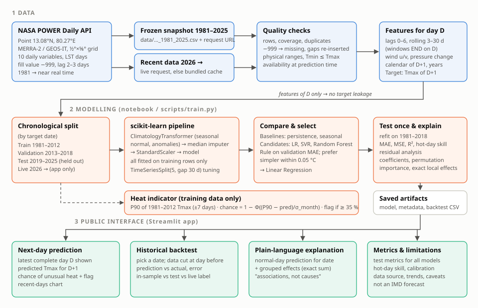

# Explainable Next-Day Extreme Heat Prediction for Chennai

*Individual technical report: draft (about 2–3 pages when printed with the two figures)*
*Author: [your name, register number] · Course: [course code], SRM · Date: [submission date]*

## 1. Climate issue

Extreme heat is one of the most direct health risks of a warming climate. Coastal Chennai combines high
temperatures in April–June (mean daily maximum 36.4–36.6 °C in April–May in the dataset used here) with
high humidity, which limits the body's ability to cool by sweating. Warnings even one day ahead let
people shift outdoor work and let hospitals and water services prepare. This project builds a
transparent, reproducible tool that predicts tomorrow's maximum temperature for Chennai, estimates the
chance that the day will be *unusually hot for Chennai*, and explains each prediction in plain language.
It is a learning tool, **not** an India Meteorological Department (IMD) forecast or heat-wave alert.

## 2. Scientific principle

Daily maximum temperature is set by the surface energy balance. Incoming sunshine heats the ground and
the air above it, and clouds, rain, evaporation and advection (wind carrying air from elsewhere) remove
or add heat. Four principles make next-day temperature partly predictable from today's observations:

1. **Persistence:** air masses, soil moisture and sea-surface temperature change slowly. In the data,
   the day-to-day autocorrelation of the Tmax anomaly is 0.73.
2. **Seasonality:** solar elevation and the monsoon cycle set the normal for each date.
3. **Moisture and rain:** wet days are cooler. Days with more than 20 mm of rain average 1.5 °C below
   normal.
4. **Wind regime:** sea breezes moderate coastal maxima, and offshore westerlies can bring hot inland
   air. (This was *not* visible in the gridded daily-mean wind; see §6.)

A supervised regression model learns a statistical mapping from today's conditions to tomorrow's
maximum temperature. Its learned effects are associations, not proofs of physical cause.

## 3. Data

* **Source:** NASA POWER Daily API v2.10.3, point request at 13.0827° N, 80.2707° E, community `AG`,
  time standard LST. Exact request: see README.
* **Underlying data:** GMAO MERRA-2 reanalysis on a ½° × ⅝° grid (≈55 × 68 km). The most recent weeks
  come from GEOS-IT on the same grid. Publication lag is 2–3 days, and recent values may later be
  revised. Values are **grid-cell averages**, which can differ from IMD station readings (Nungambakkam,
  Meenambakkam).
* **Variables (10):** Tmax, Tmin, Tmean, dew point, relative and specific humidity, bias-corrected
  rainfall, wind speed and direction at 2 m, and surface pressure.
* **Quality checks:** 16,436 rows × 10 columns covering 1981-01-01 to 2025-12-31. There were no missing
  calendar days, no duplicate dates, no −999 fill values, no values outside physical ranges, and no day
  with Tmin > Tmax or Tmean outside [Tmin, Tmax]. All inputs are daily values from day D or earlier, so
  all are available when the forecast for D+1 is issued.

## 4. Method

**Features (41 model inputs).** These are Tmax for the last 7 days; 3-, 7-, 14- and 30-day means
(windows end on day D); recent Tmin, Tmean and day–night range; humidity; 1-, 3-, 7- and 30-day rain
totals; wind east–west and north–south components; pressure and its 1-day change; the calendar position
of D+1; and a years-since-1981 drift term. A custom pipeline step adds the seasonal normal for D+1 and
today's anomaly from normal.

**Leakage control.** The split is chronological by target date: training 1981–2012 (11,657 days),
validation 2013–2018 (2,191) and test 2019–2025 (2,557). The seasonal normal, median imputation and
scaling are fitted inside a scikit-learn pipeline on training rows only. Hyperparameters were tuned with
5-fold `TimeSeriesSplit` with a 30-day gap inside 1981–2012. Automated tests confirm three things:
changing future data never changes past features, changing the target day never changes its own
prediction, and the app's predictions match the documented backtest file.

**Models.** There are two baselines (persistence, "tomorrow = today", and a seasonal average) and three
candidates: Linear Regression, RBF Support Vector Regression and Random Forest. The **selection rule**,
fixed before testing, picks the lowest validation MAE but prefers a simpler model within 0.05 °C.

**Heat indicator.** "Unusually hot for Chennai" means Tmax above the 90th percentile of 1981–2012 Tmax
within ±7 days of the same calendar date. It ranges from 28.3 °C in late December to 40.6 °C in mid-May.
The chance of an unusually hot day is 1 − Φ((threshold − prediction)/σ), where σ is the model's
cross-validated error spread for that month (0.61 °C in December to 1.65 °C in May). The flag is raised
at a chance of 35 % or more, a cut-off chosen on validation by maximum F1. This is a project-defined
indicator, not IMD's heat-wave criterion.

**Explanation.** Because the model is linear, each prediction splits *exactly* into a "normal day for
this date" value plus one contribution per input (coefficient × standardised departure from normal).
These contributions are summed into seven groups for display.

**System diagram:** `reports/system_diagram.svg` (labelled data → modelling → interface flow).

## 5. Results (measured, test period 2019–2025)

| Model | MAE °C | MSE °C² | RMSE °C | R² |
|---|---|---|---|---|
| Persistence | 0.854 | 1.456 | 1.207 | 0.868 |
| Seasonal average | 1.195 | 2.511 | 1.584 | 0.772 |
| **Linear Regression (deployed)** | **0.766** | **1.118** | **1.058** | **0.899** |
| SVR (RBF) | 0.741 | 1.069 | 1.034 | 0.903 |
| Random Forest | 0.754 | 1.090 | 1.044 | 0.901 |

* All three ML models beat both baselines on validation and test. Linear Regression lowers MAE by
  10.3 % relative to persistence, and does so in 11 of 12 months; the exception is February, at
  0.48 vs 0.46 °C. On validation SVR was better by 0.023 °C, within the tolerance, so the simpler, exactly
  explainable linear model was selected.
* **Errors are seasonal and largest in May–June** (MAE 1.29 and 1.17 °C), against 0.39 °C in January.
* **Sudden changes are the main failure.** After a jump of more than 2 °C the model under-predicts by
  1.92 °C on average (104 days); after a drop of more than 2 °C it over-predicts by 2.48 °C (118 days).
* **Unusually hot days (192 in the test period).** All regression models under-predict them, by 1.05 °C
  for Linear Regression, against persistence's 0.59 °C. The probability flag hit 84 of the 192 (recall
  0.44, precision 0.52, F1 0.47). The plain "prediction above threshold" rule managed F1 0.35, and
  persistence 0.49. The predicted chances are well calibrated: days given 30–50 % were hot 35 % of the
  time. **The heat flag therefore does not beat persistence on F1**, which is stated openly in the app.
* Example: on the hottest test day, 3 May 2019, the actual Tmax was 41.4 °C. The model predicted
  39.9 °C with a 47 % chance of unusual heat, so the flag was on.
* **Most influential inputs** (permutation importance on test): mean temperature of day D, specific
  humidity, the calendar day (through the seasonal normal), relative humidity, the east–west wind
  component and Tmax of day D. Several are strongly correlated, so individual coefficients should not be
  read in isolation.
* **Design history.** The first design had no drift term and flagged heat only when the predicted
  value crossed the threshold. On test it caught 17 % of hot days (log `outputs/run_logs/run1_design_v1.txt`).
  Two changes were then chosen **using validation data only**, and the test period was scored a second
  time (`run2_design_v2.txt`). Both results are reported.

**What the 45-year record of this grid cell shows.** Annual-mean Tmax has almost no linear trend
(−0.02 °C/decade), and April–June Tmax has a slightly negative one (−0.13 °C/decade). Tmin has risen by
+0.11 °C/decade, relative humidity by +0.65 %/decade and specific humidity by +0.25 g/kg per decade.
Days above the 1981–2012 threshold made up 9.4 % of days in 1981–2012 and 7.5 % in 2019–2025. Warmer,
more humid nights still raise heat stress, but this description of one reanalysis cell (simple
least-squares fits, no significance test) is **not** a climate-trend or attribution analysis. Station
trends were not examined.

## 6. Creative contribution

* **Implemented:** (1) a Chennai-specific, seasonally varying heat threshold built only from training
  years; (2) a calibrated "chance of unusual heat" that turns a single number into a risk statement;
  (3) exact, plain-language explanations of every prediction relative to a normal day for that date;
  (4) an interactive backtest. A visitor picks any date from 1981 to the present and sees the prediction
  made from data that is physically cut off at the day before, next to what actually happened. Each date
  is labelled as in-sample, held-out test or live.
* **Measured:** the results in §5.
* **Proposed (not implemented):** add station data from IMD where licensing allows; add forecast
  inputs from a numerical weather model; quantile regression for the upper tail; a heat index that
  combines temperature and humidity; Chennai-specific cyclone and sea-breeze indicators.

No new ML algorithm is claimed. The novelty lies in how these parts are combined and presented.

## 7. Limitations

* Gridded reanalysis is not station data. It smooths sea-breeze and urban heat-island effects.
* The model is a one-day statistical model. It cannot foresee cyclones, sudden rain or monsoon onset,
  and it under-predicts heat peaks.
* The heat indicator is project-defined, not an IMD alert. The flag does not beat persistence on F1.
* Data arrive 2–3 days late. The app's "next day" is the day after the latest data, which may already
  be in the past.
* Learned effects are associations. In this dataset the daily-mean westerly wind component was *not*
  associated with hotter April–June days (35.7 vs 36.3 °C), even though land winds are known to bring
  heat. With correlated inputs, a single effect can look counter-intuitive.
* SVR's best setting (C = 30, ε = 0.5, γ = 0.002) lies on the edge of the searched grid, so SVR might
  improve a little with a wider search. This was not pursued, because the selection rule favours the
  exactly explainable linear model when the gap is this small.
* The test period was scored twice (design v1 and v2). The changes were justified on validation data,
  but some optimism cannot be ruled out. 2026 data, which is outside all fitting, is shown live in the
  app as a further check.
* Nothing in this project attributes any single hot day to climate change.

## 8. References

1. NASA POWER Project. *POWER Daily API.* https://power.larc.nasa.gov/docs/services/api/temporal/daily/ (accessed 10 Nov 2026).
2. NASA POWER Project. *Meteorological data sources.* https://power.larc.nasa.gov/docs/methodology/data/sources_meteorology/ (accessed 10 Nov 2026).
3. Gelaro, R. et al. (2017). The Modern-Era Retrospective Analysis for Research and Applications, Version 2 (MERRA-2). *Journal of Climate*, 30, 5419–5454. https://doi.org/10.1175/JCLI-D-16-0758.1
4. Pedregosa, F. et al. (2011). Scikit-learn: Machine learning in Python. *JMLR*, 12, 2825–2830.
5. IMD heat-wave criteria: add the current IMD document you consult, if you cite IMD definitions. This
   project does not reproduce them.

*Data acknowledgement:* These data were obtained from the NASA Langley Research Center POWER Project
funded through the NASA Earth Science Division.

**Figures to include when printing:** `outputs/figures/eda_overview.png` (seasonal cycle, trends,
exceedance) and `outputs/figures/pred_vs_actual_residuals.png` (test-period fit and residuals).
